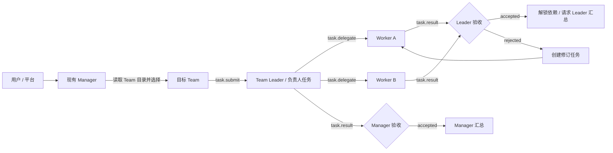

# AgentTeams Manager → Team Leader 与结果验收设计

## 目标

在不推翻现有持久化协作内核的前提下，把当前“Manager 派任务后，Worker 一返回结果就直接完成”的流程升级为明确的分层协作：Manager 只向直属 Team Leader/负责人派发，Leader 再向自己的直属 Worker 拆分；每一级执行结果先提交给协调者验收，只有验收通过才能解锁依赖和进入上级汇总。



## 保留的架构

- `TaskRun + AgentTaskNode + AgentTaskDependency` 继续作为任务树与 DAG 的事实来源。
- `coordinator_agent_id` 表示验收与协调责任人，`assignee_agent_id` 表示执行责任人。
- 现有团队成员、直属关系、能力目录、最大深度/子节点/轮次/节点数校验继续生效。
- Matrix/Local Transport 只负责消息到达；协作服务负责状态、权限、依赖和下一步。
- 所有业务副作用继续经过 `Policy → Plugin Gateway → Capability Executor → Harness/Adapter`。
- Outbox、幂等键、事件流、失败传播、用户所有权和最终汇总规则保持不变。

## 关键变化

### 1. 显式分层派发

根节点仍是 Manager 的 Mission。Manager 的一级委派记录为 `team_assignment`；具有直属下属的执行人视为 Team Leader，后续只能向关系图中的直属 Worker 委派。普通叶子任务记录为 `worker_task`。这一分类保存在节点中并通过 API 暴露，前端可直接展示 Manager、Leader、Worker 三层，不再靠标题猜测。

为兼容数据库诊断等扁平团队：若 Manager 的直属执行人没有下属，该一级节点仍是 `worker_task`，不会强制伪造 Leader 层。

### 2. 结果验收门

Worker/Leader 发送 `task.result` 后：

1. 节点从 `running` 进入 `submitted`，保存候选结果，但不设置完成时间。
2. 平台向 `coordinator_agent_id` 发送 `task.result.submitted`，节点进入 `reviewing`。
3. 协调者只能返回 `task.result.accepted` 或 `task.result.rejected`。
4. `accepted` 才将节点置为 `completed`、解锁依赖、触发父节点汇总。
5. `rejected` 将原节点置为 `revision_requested`，保留候选结果与驳回意见，并创建一个指向原节点的修订节点；依赖者改为等待最新修订节点。

### 3. 修订历史

`AgentTaskNode` 增加：

- `node_kind`: `mission | team_assignment | worker_task`
- `revision_of_task_id`: 可空，指向被驳回的上一版节点

旧 SQLite 数据库通过现有轻量兼容迁移补列。原节点不删除、不覆盖，事件中保留提交、驳回与新修订节点 ID。

### 4. 权限和幂等

- `task.result` 仍只能由节点执行人提交。
- 接受/驳回只能由节点协调者提交，并继续核验 Matrix sender、团队成员、trace、parent 和幂等键。
- 重放相同消息不重复创建修订节点或重复解锁下游。
- 驳回必须带非空、限长、去敏后的 `feedback`。

## 状态机

```text
blocked -> assigned -> accepted -> running -> submitted -> reviewing
                                                    |          |
                                                    |          +-> completed
                                                    |          +-> revision_requested -> 新 revision 节点
                                                    +-> failed / timed_out / cancelled
```

父节点只把“已验收完成”的最新子任务视为完成。`submitted`、`reviewing` 和 `revision_requested` 都不能解锁下游，也不能触发父汇总。

## 分阶段落地

本次完成一个可运行的纵向切片：协议、状态机、修订节点、运行时自动验收响应、本地演示、API 类型、前端状态展示和回归测试一起落地；随后在同一 Manager 上补充 Team 目录读取与自动选择。普通任务可不传 `team_id` / `leader_agent_id`，Manager 根据 Team 名称、说明、能力、Leader 和 Worker 名册选择，服务端再次校验只能交给该 Team 登记的 Leader，并记录 `team.selected`。显式指定 Team 的旧调用继续兼容。跨 Team Room 的多运行配置仍属于后续部署能力，不新增独立 Global Manager 进程。

## 验收标准

- Worker 提交后节点不是 `completed`，依赖任务仍是 `blocked`。
- 未显式指定 Team 时，Manager 只能从已登记 Team 目录中选择，并且接收人必须是该 Team 的 Leader。
- 非协调者无法接受或驳回结果。
- Leader 接受后仅执行一次解锁/汇总。
- Leader 驳回后创建可执行修订节点，原结果和驳回意见可审计。
- 本地演示与真实 Agent Runtime 都能消费 `task.result.submitted` 并返回验收决定。
- 后端目标测试、API/运行时/本地演示回归和前端目标测试通过。
